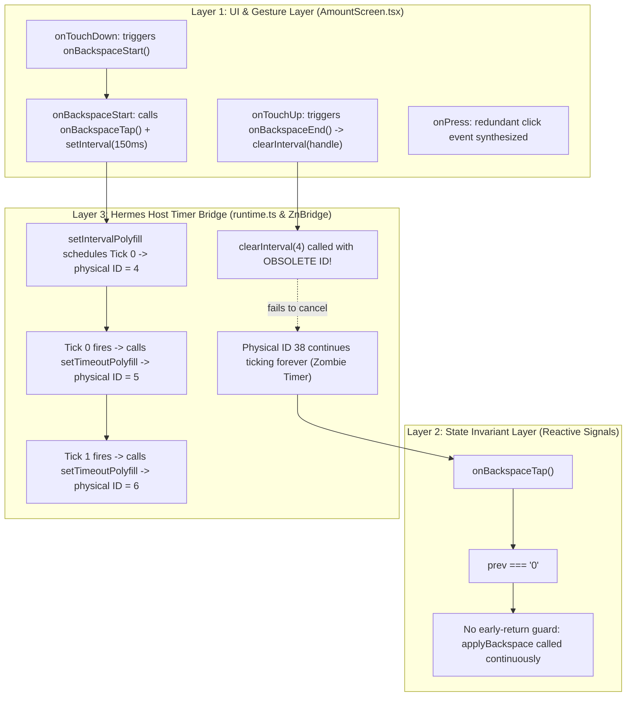

# Architecture Deep-Dive: Keypad Rapid Backspace, Zombie Recurring Timers & Virtual Handle Abstraction

**Document:** `4b-keypad-zombie-timers-architecture.md`  
**Author / Context:** Zero-Native (`zn`) Runtime Research & Experiment 4 Hardening  
**Target Audience:** Argon & Opus (Framework Designers, Runtime Engineers, Architects)  
**Date:** 2026-10-28  

---

## 1. Executive Summary

During testing of Experiment 4 on physical hardware (Lava Blaze 2 5G), an insidious UI behavior was uncovered on the payment amount keypad:

> **The Phenomenon:**  
> A user enters an amount (e.g., `₹ 1,234`), presses and holds the backspace button (`⌫`) until the amount drops to `0`, keeps holding for 1–2 seconds more, and then releases their finger. Subsequently, tapping any digit (e.g., `5`) displays the digit for a single frame, after which it is **instantly erased back to `0`**.

This was not a simple UI glitch. It was caused by a fundamental architectural impedance mismatch in the standalone Hermes V1 JavaScript runtime: **the naive polyfilling of `setInterval` using chained recursive `setTimeout` host calls without a persistent logical handle abstraction.**

This document provides a forensic post-mortem of the defect, details the exact execution trace, explains why the bug only manifests under sustained touch duration, outlines the runtime fix, and presents four concrete architectural recommendations for the upcoming core framework design by Argon and Opus.

---

## 2. Forensic Post-Mortem: The Layered Failure

The bug arose from a confluence of three distinct architectural layers:



---

## 3. The Core Defect: Naive Recursive Timer Chaining

### 3.1 How Timers Work in Zero-Native
Hermes V1 is an embedded engine. Unlike a web browser or Node.js, it has **zero built-in timers**.
Zero-Native bridges timers to Android's native OS loop via C++ JNI and Kotlin:
- JS calls `__zn_setTimeout(id, delayMs)` $\to$ C++ $\to$ Kotlin `Handler(jsThread.looper).postDelayed(..., delayMs)`.
- When the timer fires, Kotlin invokes `ZnBridge.onTimerFired(id)` $\to$ C++ $\to$ JS `globalThis.__zn_timerFired(id)`.

### 3.2 The Flawed Polyfill
To support standard JavaScript `setInterval(fn, ms)`, the runtime initially used a textbook recursive timeout pattern:

```typescript
// ❌ FLAGGED IMPLEMENTATION (runtime.ts)
let nextTimerId = 1;
const activeTimers = new Map<number, () => void>();

export function setTimeoutPolyfill(fn: () => void, delayMs: number): number {
  const id = nextTimerId++;
  activeTimers.set(id, fn);
  __zn_setTimeout(id, delayMs);
  return id;
}

export function clearTimeoutPolyfill(id: number) {
  activeTimers.delete(id);
  __zn_clearTimeout(id);
}

export function setIntervalPolyfill(fn: () => void, intervalMs: number): number {
  let timerId: number;

  function tick() {
    fn();
    // 💥 BUG: Every recurring tick allocates a BRAND NEW physical ID!
    timerId = setTimeoutPolyfill(tick, intervalMs);
  }

  // Initial schedule allocates ID 4 (for example)
  timerId = setTimeoutPolyfill(tick, intervalMs);

  // Returns ID 4 to the caller!
  return timerId;
}
```

### 3.3 The Execution Trace of a Zombie Timer

Consider a user holding backspace for 2.5 seconds:

| Time Elapsed | Event | `nextTimerId` | Physical ID Allocated | ID Stored in App State (`backspaceTimer`) | Status |
|:---:|:---|:---:|:---:|:---:|:---|
| **0 ms** | `onTouchDown` fires. Calls `setInterval(onBackspaceTap, 150)`. | 4 | **ID 4** | **`backspaceTimer = 4`** | Scheduled in Android Handler for +150ms |
| **150 ms** | Android Handler fires ID 4. `tick()` runs. Calls `setTimeoutPolyfill`. | 5 | **ID 5** | Unchanged (`4`) | ID 4 deleted from `activeTimers`. ID 5 scheduled. |
| **300 ms** | Android Handler fires ID 5. `tick()` runs. Calls `setTimeoutPolyfill`. | 6 | **ID 6** | Unchanged (`4`) | ID 5 deleted. ID 6 scheduled. |
| ... | *(User continues holding for ~2.5s)* | ... | ... | ... | Chaining repeats 16 times. |
| **2,400 ms** | Android Handler fires ID 19. `tick()` runs. Calls `setTimeoutPolyfill`. | 20 | **ID 20** | Unchanged (`4`) | ID 19 deleted. **ID 20 is actively scheduled**. |
| **2,500 ms** | **User lifts finger (`onTouchUp`).** `onBackspaceEnd` executes: `clearInterval(backspaceTimer)` | 20 | N/A | Target: **ID 4** | **`activeTimers.delete(4)` and `__zn_clearTimeout(4)` called!** |

### 3.4 Why the Cancellation Silently Failed
1. **Target ID 4 had already expired 2,350 ms ago.** `activeTimers.get(4)` was already `undefined`. Android's message queue had already consumed Runnable 4.
2. **Target ID 20 was currently active in Android's message queue.** But JavaScript had **zero reference** to ID 20! The variable `timerId` inside the closure was reassigned, but the outside caller only held the integer `4`!
3. **The Loop Became Immortal:**
   - 150 ms later (at 2,550 ms), Runnable 20 fired.
   - `tick()` ran `onBackspaceTap()`.
   - `tick()` scheduled **ID 21**.
   - Runnable 21 fired $\to$ scheduled **ID 22** $\to$ ad infinitum.

### 3.5 The "Digit Eraser" Phenomenon
When the user subsequently tapped digit `5`:
1. Tap event fired: `setAmountStr("0", "5")` $\to$ signal became `"5"`.
2. Compose re-rendered: `₹ 5` displayed on screen.
3. Less than 150 ms later, Zombie Timer ID 25 fired on the `zn-js` thread.
4. `onBackspaceTap()` executed: deleted `'5'`, returned `"0"`.
5. Compose re-rendered: `₹ 0` displayed on screen.
To the human eye, the digit was erased the instant it was pressed.

---

## 4. The Solution: Virtual Logical Handle Abstraction

To solve this fundamentally, we decoupled **Logical Interval Handles** from **Physical Host Timer Instances**.

### 4.1 Implementation Pattern
```typescript
// ✅ HARDENED IMPLEMENTATION (runtime.ts)

let nextIntervalId = 1;
// Map of logical handle -> cancellation closure
const activeIntervals = new Map<number, () => void>();

export function setIntervalPolyfill(fn: () => void, intervalMs: number): number {
  // 1. Allocate an immutable LOGICAL handle for the entire lifetime of this interval
  const handleId = nextIntervalId++;
  
  let currentTimeoutId: number | null = null;
  let isCancelled = false;

  function tick() {
    // 2. Cancellation barrier: if cancelled while in event queue, do NOT execute
    if (isCancelled) return;

    try {
      fn();
    } catch (e) {
      console.error("Error in setInterval callback", e);
    }

    // 3. Reschedule only if strictly active
    if (!isCancelled) {
      currentTimeoutId = setTimeoutPolyfill(tick, intervalMs);
    }
  }

  // 4. Initial schedule
  currentTimeoutId = setTimeoutPolyfill(tick, intervalMs);

  // 5. Register cancellation closure against the logical handleId
  activeIntervals.set(handleId, () => {
    isCancelled = true;
    if (currentTimeoutId !== null) {
      clearTimeoutPolyfill(currentTimeoutId);
      currentTimeoutId = null;
    }
  });

  // 6. Return the stable logical handle
  return handleId;
}

export function clearIntervalPolyfill(handleId: number) {
  const cancel = activeIntervals.get(handleId);
  if (cancel) {
    cancel();
    activeIntervals.delete(handleId);
  }
}
```

### 4.2 Invariant Boundary Guards in Keypad
In addition to the runtime fix, defensive guards were applied at the UI layer in [`AmountScreen.tsx`](file:///c:/work/zero-native/exp4-flow/js/screens/AmountScreen.tsx):

```typescript
// Invariant: Backspace on "0" or empty string is strictly idempotent and causes NO state change
const onBackspaceTap = () => {
  setAmountStr((prev) => {
    if (prev === "0" || prev === "") return "0";
    return applyBackspace(prev);
  });
};
```

And the touch event mapping was aligned with ZeroBill RN (`TxnEnteringAmountView.tsx:326`):
```tsx
// KeypadButton backspace: relies strictly on touch lifecycle, no synthetic onPress
<KeypadButton
  label="⌫"
  onTouchDown={onBackspaceStart}
  onTouchUp={onBackspaceEnd}
/>
```

---

## 5. Architectural Recommendations for Argon & Opus

This finding provides critical design lessons for the production-grade Zero-Native framework.

### Recommendation 1: Virtual Async Handle Registry in Runtime Kernel
In embedded runtimes (Hermes, QuickJS), asynchronous tasks (timers, microtasks, fetch requests, hardware listeners) must not expose raw host OS IDs to application code.
- **Rule:** The runtime kernel must maintain a unified **Async Handle Registry** where handles are opaque tokens (`Handle<Timer>`, `Handle<Request>`).
- **State Machine:** Every handle must transition through an explicit lifecycle:
  $$\text{Allocated} \longrightarrow \text{Pending} \longrightarrow \left[ \text{Fired} \mid \text{Rescheduled} \mid \text{Cancelled} \right] \longrightarrow \text{Disposed}$$
- **Automatic Garbage Collection:** When a component or screen unmounts, the framework should automatically cancel and flush all async handles registered within that component's scope (similar to React's `useEffect` cleanup or Jetpack Compose `DisposableEffect`).

### Recommendation 2: Signal Short-Circuiting (Idempotent Mutations)
In our reactive signals implementation (`signal.ts`):
```typescript
export function signal<T>(initialValue: T) {
  let value = initialValue;
  const subscribers = new Set<() => void>();
  
  function get() { /* track dependency */ return value; }
  
  function set(next: T | ((prev: T) => T)) {
    const nextVal = typeof next === "function" ? (next as any)(value) : next;
    // 🛡️ CRITICAL GUARD: If the value did not change, NEVER notify subscribers!
    if (Object.is(value, nextVal)) return;
    
    value = nextVal;
    subscribers.forEach((fn) => fn());
  }
  return [get, set] as const;
}
```
If a rogue timer or redundant tap attempts to set `"0"` when the signal is already `"0"`, the signal must short-circuit in $O(1)$ time, preventing the reactive graph from recalculating and preventing unnecessary Compose UI tree reconciliation.

### Recommendation 3: Standardized Gesture & Touch Event Protocol
Web and React Native conflate mouse clicks with touch events. In high-frequency POS/payment keypads:
- A button with `onTouchDown` and `onTouchUp` must **suppress** the synthetic `onPress` (click) event to prevent double execution.
- Touch handlers must support `onTouchCancel` (e.g. if the user presses backspace and slides their finger off the button without lifting). If `onTouchCancel` is not wired, the `onTouchUp` handler never executes, leading to the same runaway timer condition.
- **Recommendation:** Implement a unified `useHoldGesture(action, { intervalMs: 150, initialDelayMs: 400 })` hook that encapsulates cancellation, sliding off bounds, and unmount cleanup.

### Recommendation 4: Diagnostic Watchdog for Event Loop & Timer Leaks
To catch runaway loops during development:
- **Timer Execution Counter:** If a recurring interval callback executes more than $N$ times (e.g. 100 times) without any user interaction or state change, the runtime should log a warning:  
  `[ZN_WATCHDOG] High-frequency timer (handleId=X) running without state change (count=100)`.
- **Active Timer Dump:** Expose `__zn_debug_getActiveHandles()` callable from Android ADB:
  ```bash
  adb shell am broadcast -a dev.zeronative.DUMP_HANDLES
  ```
  This immediately exposes any leaked timers, background fetch calls, or dangling event listeners.

---

## 6. Summary Comparison Table

| Dimension | Naive Recursive Chaining (Before) | Logical Handle Abstraction (After) | Framework Target (Argon & Opus) |
|---|---|---|---|
| **Interval Handle Identity** | Volatile (changes on every tick) | **Stable (immutable `handleId`)** | Opaque `Handle<Timer>` token |
| **`clearInterval` Guarantee** | Only works before Tick 0 fires | **Guaranteed instant cancellation** | Atomic cancellation token |
| **Touch Gesture Safety** | Relied on `onPress` + `onTouch` | **Clean `onTouchDown` / `Up`** | Dedicated `useHoldGesture` hook |
| **State Mutation on Zero** | Continuous re-evaluation | **Guarded idempotent no-op** | Signal short-circuit (`Object.is`) |
| **Memory / CPU Impact** | Infinite background thread churn | **Zero churn after release** | Automatic scope-based disposal |

