# Architectural Problem Statement: 10 Lakh (1,000,000) Records Cursor Architecture

**Target Audience:** Argon & Opus Framework Designers  
**Project:** Zero-Native (`zn`)  
**Context:** Scale Frontier (Offline Ledger / Catalogue)  
**Date:** October 28, 2026  

---

## 1. Problem Definition: The Physical Limits of Mobile RAM

While Frontier 2 proved that Zero-Native handles **10,000 items in Hermes memory** with **3.8 ms / 90 FPS** flings and **6.2 MB Dalvik Heap**, scaling to **10 Lakh (1,000,000) records** (e.g. 3 years of retail ledger history or a complete wholesale catalogue) breaks down under raw memory physics:

### The JS Heap Math
- In Hermes, V8, or JSC, a single JavaScript object with 6 properties (`id`, `merchant`, `amount`, `time`, `category`, `isCredit`) consumes $\sim 350 - 500\text{ bytes}$ of VM heap memory.
- $1,000,000 \times 400\text{ bytes} \approx \mathbf{400\text{ MB of JS Heap}}$.
- On budget Android devices (such as our Lava Blaze 2 5G with 4GB/6GB RAM and a 256MB ART heap limit), **allocating 1,000,000 JS objects causes an immediate out-of-memory crash before UI rendering even starts**.

### The Disk Reality
- On disk, 1,000,000 transactions in SQLite (or a memory-mapped flat binary table) take $\sim \mathbf{80 - 120\text{ MB}}$ with B-Tree indexes on `(timestamp DESC)`.
- **Constraint:** At no point may the app load more than **100 rows into RAM**.

---

## 2. The Three Architectural Dilemmas for Opus

```mermaid
graph TD
    subgraph Dilemma A: Synchronous JSI Pull from UI Thread
        A1[Compose UI Thread LazyColumn] -->|Synchronous JSI Call| A2[HermesRuntime]
        A2 -->|Query SQLite / Mem| A3[Return Row 450]
        style A2 fill:#f87171,stroke:#dc2626
    end

    subgraph Dilemma B: Asynchronous Viewport Sliding Window
        B1[Compose UI Thread LazyColumn] -->|snapshotFlow firstIndex| B2[JNI Event onScrollWindow]
        B2 -->|Background zn-js Thread| B3[Hermes queries SQLite]
        B3 -->|JSON Batch 50 items| B4[Kotlin windowMap update]
        style B3 fill:#fbbf24,stroke:#d97706
    end

    subgraph Dilemma C: Direct Native C++ Cursor to Compose
        C1[Compose UI Thread LazyColumn] -->|Direct Fast Memory Lookup| C2[C++ SQLite / mmap Reader]
        C2 -->|0 Hermes JS Involvement| C1
        C3[Hermes JS] -->|Only defines query filter / receives tap events| C2
        style C2 fill:#34d399,stroke:#059669
    end
```



---

### Dilemma A: Synchronous JSI Pull from the UI Thread (The C++ Threading Trap)

**The Idea:** When Compose composes row `i`, Kotlin calls C++ JNI: `ZnBridge.nativeGetItem(listId, i)` which synchronously reads row `i` via JSI from Hermes.

**Why Argon/Flash Flagged This as Fatal:**
1. **Thread Ownership Law (`ARCHITECTURE.md` §7.2):** `HermesRuntime` is strictly single-threaded and owned by the background `zn-js` thread.
2. **SIGSEGV Danger:** If the Android Main Thread calls into `HermesRuntime` while `zn-js` is executing a network callback, timer, or garbage collection, the app immediately crashes with native memory corruption (`SIGSEGV`).
3. **Mutex Deadlocks:** If a `std::mutex` is placed around Hermes, the Main Thread blocks whenever Hermes runs a GC cycle or processes an API response. **The UI thread freezes and drops frames during flings.**

---

### Dilemma B: Asynchronous Viewport Sliding Window (The Shift Lag)

**The Idea:** Keep Hermes as the sole data controller. Compose emits `onScrollWindow(start, count)` to `zn-js`. Hermes runs `SELECT * FROM txns LIMIT 50 OFFSET ?` and sends 50 slot dictionaries across JNI.

**The Failure Mode at 1,000,000 Records:**
- When the user executes a fast fling at $5,000\text{ px/sec}$, Compose moves through 150 rows in 300 ms.
- If SQLite disk I/O on the background thread takes $15\text{ ms}$, plus JNI serialization (2 ms), plus thread scheduling, the JS response arrives 30–50 ms behind the viewport.
- While Compose handles this gracefully by rendering exact-height 72.dp skeleton cards without jitter, **the user sees grey skeleton cards for 30–50 ms before text snaps in**.

---

### Dilemma C: Direct Native C++ Cursor (Bypassing Hermes for Row Data)

**The Radical Proposal:** Should row data for massive virtual lists bypass JavaScript entirely?

**How It Works:**
1. **Hermes sets the Intent / Filter:**
   ```tsx
   <VirtualList
     dataSource="sqlite://ledger.db?query=SELECT * FROM txns ORDER BY date DESC"
     template={(slot) => <Row>...</Row>}
     onRowPress={(id) => handlePress(id)}
   />
   ```
2. **Native C++ Engine:**
   - C++ opens the SQLite cursor or memory-maps the binary ledger file directly.
   - Compose `LazyColumn` requests row `i`.
   - C++ reads row `i` directly into the slot dictionary in $< 0.1\text{ ms}$ on the UI thread without crossing JNI or touching Hermes.
3. **Hermes Role:**
   - Hermes never sees the 1,000,000 rows.
   - Hermes only handles business logic and user actions (e.g. when row #849,201 is tapped, Hermes receives `onRowPress(849201)`).

---

## 3. Key Architectural Questions for Argon & Opus

1. **Purity vs. Pragmatism:**  
   Does allowing C++ to stream SQLite rows directly to Compose violate the Zero-Native reactive signal model, or is a dedicated native `DataSource` primitive the only mathematically viable way to handle 1,000,000 items on low-end hardware?
2. **Offline-First Reactive Queries:**  
   If an incoming payment arrives via WebSocket, how does Hermes invalidate the C++ SQLite cursor without triggering a full UI remount?
3. **Template Compilation Boundary:**  
   When `.zn.ui` compiles the row template AOT, should the slot binder generate C++ struct offsets directly from the SQLite column schema?

---
*Document prepared for collaborative iteration with Argon & Opus.*

